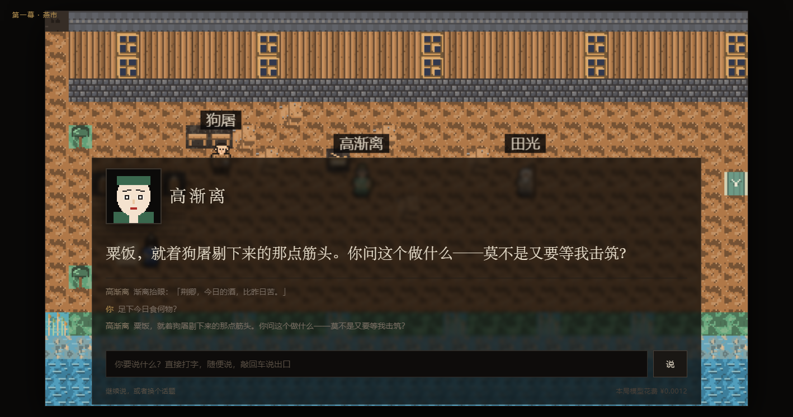
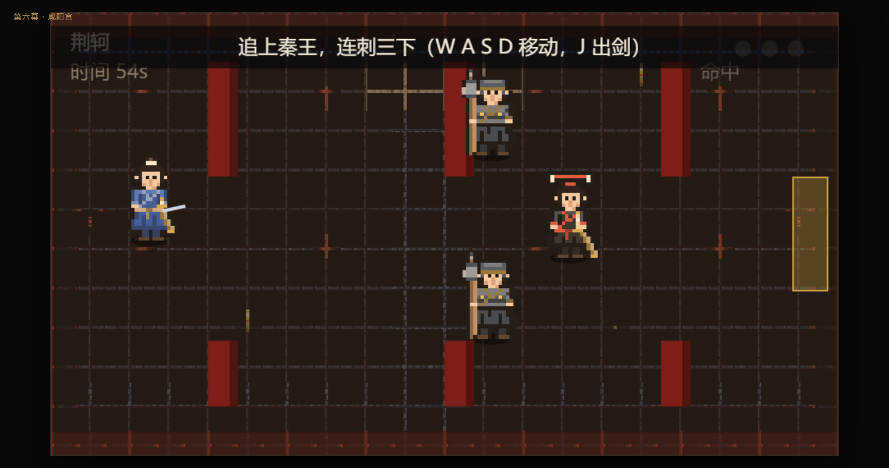
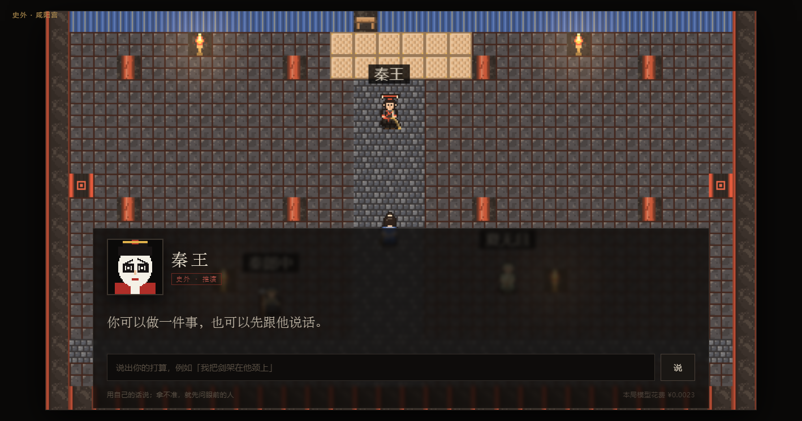
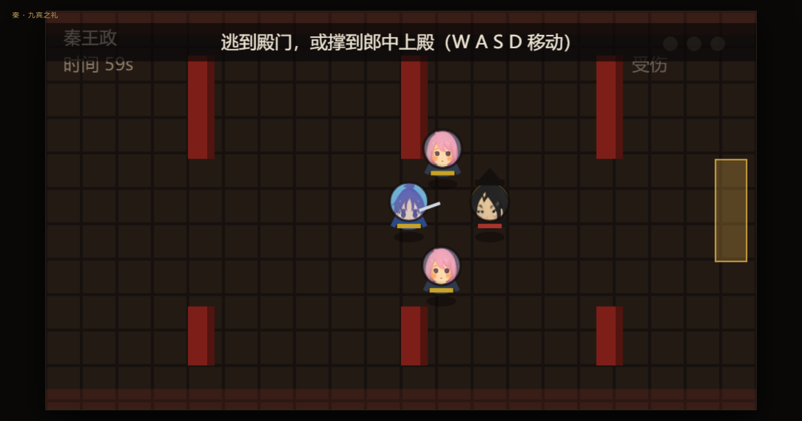
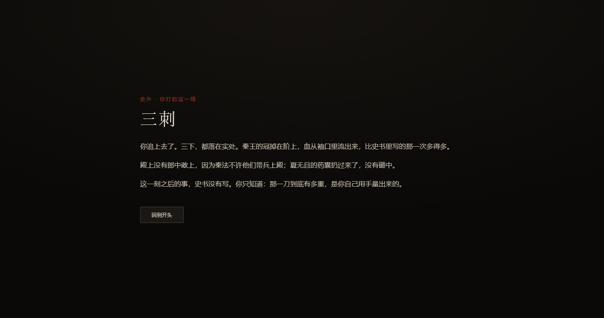

# Week 8 · 图穷 (The Map Unrolls)

A historical simulation in which you are 荆轲 — or 秦王. You drink in the Yan
market, watch a hermit kill himself, ask a Qin general for his head, stand at the
Yi river in white, and walk into the Qin palace with a map and a poisoned dagger.
Or you sit on the throne and let the Yan envoy in.

Five things make it a simulation rather than a story with buttons:

1. **You walk the place and find people.** The game is a small pixel RPG: arrow keys or
   WASD move 荆轲 through the tile map, the people you can talk to stand in it with
   their names over their heads, and **E** opens the conversation when you are close
   enough. Walking is the main loop; dialogue is what happens when you reach someone.
2. **You say what you want, and you never click an option.** When the dialogue opens,
   you type; the model answers in that person's voice — including when you ask what
   they ate — and it quietly nudges you with a one-line hint, in that person's own
   words, when the scene is waiting for something.
3. **Both sides of the attempt are playable.** The opening screen is two cards — click
   荆轲 or 秦王, no typing. Choose 荆轲 and you live the record
   from the market to the throne hall; choose 秦王 and you spend the same day in the
   Qin court, hearing the envoy's request and deciding whether to let him in.
4. **The last minute is fought, not narrated.** The map unrolls and the hall becomes
   an arena: play 荆轲 and you have to reach the king and land three strikes; play
   秦王 and you have to get to the door, or stay alive until the guards come up the
   steps. **There is no scripted death** — the ending is whatever you do on the floor,
   and 荆轲 winning is a real ending.
5. **The art is pixel.** 48×48 脸谱 portraits, 16×24 walk sprites, 16×16 tiles.



## Run it

**Easiest: double-click [`run_game.cmd`](run_game.cmd).** It starts the server and
opens <http://127.0.0.1:8765>.

By hand:

```powershell
cd 508-coursework/week-08
python code/server.py
# then open http://127.0.0.1:8765
```

Do not double-click `game/index.html`: it is ES modules, and a `file://` page may not
load module scripts — the page now says so itself. The key lives in `week-08/.env`, is
git-ignored, and never reaches the browser. With no key the game still runs: the
portraits and the scripted branches work, and the title says the model is offline.

Chapter jump for the class demo: `?beat=a5_yi`, `?beat=a7_chaos` (the playable
divergence). Port busy: `set PORT=8766` then `python code/server.py`.

## The brief, item by item

| the brief asks for | where it is |
| --- | --- |
| the repository link, with an index | this file |
| the simulation itself, or a recording | `game/` — run the two commands above; stills in `generated/screenshots/` |
| your answer to "why not a film?" | §「Why not a film」 below, and `research/design.md` §1 |
| your source list, with provenance | `research/sources.md`; the fetched text in `sources/raw/` and `sources/processed/`, with `provenance.json` (url, revid, licence, fetch time) |
| the table of parts: evidenced / inferred / invented | `research/design.md` §7 |
| what each tool did, what the AI did, what you checked | `research/tool_log.md` |
| at least one real difficulty, with its example | `research/tool_log.md` §Difficulties — the model reverting a counterfactual, and the portrait that came back female |
| keep every prompt, input, output and cost | `research/prompts.md`; `artifacts/logs/calls.jsonl`; totals in `artifacts/logs/summary.md` |
| large files out of Git; keys out of Git | `artifacts/` is git-ignored (raw images, rejected plates, Chrome profile, logs); the key is only in `week-08/.env`, verified ignored and absent from every tracked file |
| unresolved questions in `questions.md` | [`questions.md`](questions.md) |

## Why not a film

A film gives you the ending and the explanation together: the dagger missed, the king
ran, the assassin died, and the lesson is *stated*. The simulation refuses that. Its
claim is that the failure was not one moment but the cost of four decisions, each
reasonable by itself:

- **太子丹's plan had two incompatible aims** — take the king alive and make him
  return the annexed land, *or* kill him. 荆轲 takes the harder one, and dies saying
  so: 「事所以不成者，以欲生劫之，必得约契以报太子也。」
- **The hurry.** He was waiting for a man who would have been a second hand. The prince
  suspected him, said 「日已尽矣」, and threatened to send the boy first.
- **The boy.** 秦舞阳, "人不敢忤视", turns pale at the steps. Someone has to cover for
  him, and go on alone.
- **The half-step.** 「未至身」: the sleeve tore, the long sword would not draw, and the
  Qin rule against armed courtiers meant nobody could stop him — until 「王负剑」.

You feel the price of those four only if you are the one choosing them, and you can
only *argue* with the historical figures if you are free to speak to them. That is what
a film cannot give: not the information, but the weight — and the specific regret of a
sentence you chose yourself.

## The finale: the hall is an arena



`game/js/battle.js` is a small action scene, not a cutscene. Two roles, same hall:

| you play | you win by | you lose by |
| --- | --- | --- |
| 荆轲 | reaching the king and landing **three strikes** before 55 s | the king reaches the door, or time runs out |
| 秦王 | reaching the **door** on the right, or staying alive until the clock ends | taking three strikes |

Controls: W A S D / arrows to move, **J** to strike (荆轲 only). Each hit stuns the
king for a moment, so three is possible — but he runs, and so do the guards. Nothing
is scripted: the endings (`end_assassinate`, `end_qin_escape`, `end_qin_saved`,
`end_qin_dead`) are chosen by the arena, and the structure checker verifies that all
four are reachable from play (`battleEndings` in `js/story.js`).

## Talking to people who are dead

The whole leash is in `code/server.py` (`TALK_SYSTEM`) and `game/js/engine.js`:

- the model is told who it is, what it can perceive, what the player just said, the
  last few turns, and a **closed list of intents** with one line each;
- it returns `{"reply", "intent", "option", "hint"}`; the server checks `intent` and
  `option` against the ids it sent, and anything else becomes `chitchat`;
- every character you can click now goes through this call: the seven fixed-line
  walk-ons were converted into conversations (`code/convert_talk_nodes.py`), so the
  cast answers rather than recites;
- the voice is first person with real feelings — fear, hesitation, tiredness, a
  private grudge — not an explainer: 「食？一碟冷豆，半块干饼，就着这苦酒咽下去的。你呢，
  看你这脸色，不像是好好吃过东西。」
- the `hint` is the soft guide: one sentence **in the character's own voice**
  (「他似乎在等你提起田光先生」), shown as a dim line under the box. It is never
  「请选择 A/B/C」, and it disappears when you are already on the right track;
- the engine only moves the story on an id that `story.js` already contains;
- small talk must be answered in character — 「足下今日食何物？」 → 「粗粝之食，不足挂齿」 —
  and it changes nothing.

That is the brief's rule — 「the world, not the language model, decides what actually
happens」 — implemented as a rejection, not as a request in a prompt. A misread intent
can only open a scene the script already has.

## The divergence you can play



`a7_chaos` is a real place: the same hall, the wounded king standing at the pillar and
still able to talk, the physician and a guard to address, and four decisions — force a
treaty, finish him, run, or listen first. The model writes the king's voice; the
consequence is a generated paragraph, tagged 「史外 · 推演」, and the ending card lists
「你所改变的历史」. The historical ending remains the default path.

## What is historical here, and what is not

The spine is quoted: 65 of 164 script lines carry the chapter they come from (卷086,
plus 卷006 and 卷034 for the aftermath). 31 lines are invented and marked `inv`; 68 are
narration. The item-by-item evidenced / inferred / invented table is
`research/design.md` §7. Two chapters of the *Shiji* disagree about the end (卷006 has
体解 and dates Dan's head a year later); the game follows 卷086 and 卷034 and says so
(`research/design.md` §8).

Everything is **pixel art**, as it was at the start: 48×48 portraits for the speakers,
painted like 京剧脸谱 — a red face for the wronged general, white with black eye-frames
for the king, a small white nose-patch for the clown roles (`code/make_pixel_masks.py`
draws all eleven at the final size, so nothing is downscaled),
16×24 walk sprites for the cast, and 16×16 tiles for the places. The five backgrounds
are the tile maps themselves, rendered once into images by
`code/render_pixel_scenes.mjs` (512×288 each) so the stage can show them without a
walkable world; the browser enlarges them with `image-rendering: pixelated`, so the
blocks stay square. The arena draws the same 16×24 sprites.

All art is marked **invented representation** in `research/design.md` §7.
## Screens

| | |
| --- | --- |
|  |  |
|  |  |

## Costs

| item | amount | cost |
| --- | --- | --- |
| `deepseek-chat`, all playtests | 127 calls, see `artifacts/logs/summary.md` | ¥0.1277 |
| Pollinations portraits and plates | 10 portraits + 6 plates, anonymous tier | 0 |
| Pillow pixel assets | local, deterministic | 0 |
| Wikisource | 3 chapters | 0 |

Each typed line is one call, so a ten-minute conversation costs about ¥0.01–0.02. The
rate table sits in `code/server.py`; every call logs tokens and cost.

## Folder map

```text
week-08/
|-- instructions.md            the brief, untouched
|-- README.md                  this index
|-- run_game.cmd               double-click: start the server, open the game
|-- questions.md               what is unresolved
|-- .env                       the key (git-ignored; never commit)
|-- sources/                   raw/ (as served) and processed/ (clean text) + provenance.json
|-- research/
|   |-- sources.md             S1-S3 with quotes, licences, what is not a source
|   |-- design.md              the argument, the acts, the branches, the sourcing table
|   |-- prompts.md             every prompt verbatim, with real exchanges
|   `-- tool_log.md            tools, AI vs checked, costs, difficulties, limits
|-- game/
|   |-- index.html, style.css  the world canvas, and the dialogue layer
|   |-- js/engine.js           world, walking, dialogue, intents, the world's rule
|   |-- js/story.js            68 nodes, 164 lines, 7 beats, 6 endings, talk blocks
|   |-- js/maps.js             five maps, built in code so every row is exact
|   |-- js/ai.js               the only door to the model; fails closed
|   `-- assets/
|       |-- cartoon/           11 SD portraits + 5 scene backgrounds + manifest
|       `-- legacy/            the abandoned pixel tiles/sprites and the ink portraits
|-- code/
|   |-- fetch_sources.py       Wikisource -> sources/processed
|   |-- make_pixel_assets.py   tiles and sprites
|   |-- make_portraits.py      the ten portraits
|   |-- make_illustrations.py  the ink-wash plates
|   |-- server.py              static files + /api/talk + /api/chronicle + call log
|   |-- smoke_ai.py            both endpoints, printing tokens and cost
|   |-- check_story.mjs        structure, reachability, geometry - no browser
|   |-- playtest.mjs           real browser playthrough: typing, choices, the chaos scene
|   `-- summarize_calls.py     the cost table
|-- generated/
|   |-- screenshots/           stills, regenerate with node code/playtest.mjs
|   `-- illustrations/         the two plates and their manifest
`-- artifacts/                 git-ignored: raw images, rejects, Chrome profile, logs
```

## Rebuild from nothing

```powershell
python code/fetch_sources.py         # the three chapters
python code/make_pixel_assets.py     # tiles, sprites
python code/make_portraits.py        # ten portraits (free endpoint, ~70 s each)
python code/make_illustrations.py    # two plates (the rest are rejected)
node code/check_story.mjs            # structure check, no browser
python code/server.py                # then, in another window:
python code/smoke_ai.py              # one real call each way, with cost
node code/playtest.mjs               # playthrough: typing, choices, chaos scene, screenshots
python code/summarize_calls.py       # the cost table
```

## Status

Playable end to end on the historical path and on the divergence path, with the model
live. Known limits, also in `questions.md`: the portraits are mood, not costume
evidence; the model's intent reading is good but not perfect, and a misread can only
open something the script already allows; and the game still needs the Python server
(no single-file build).
